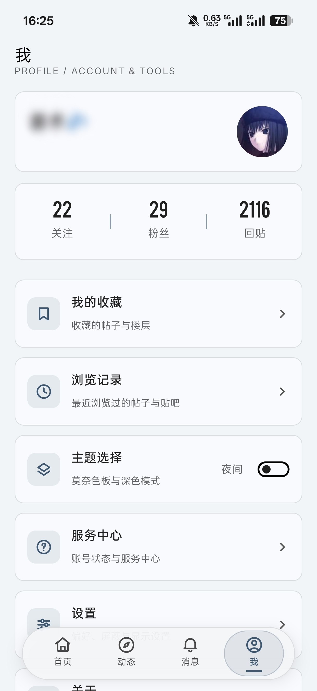
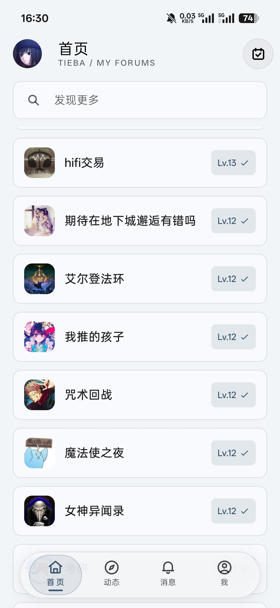
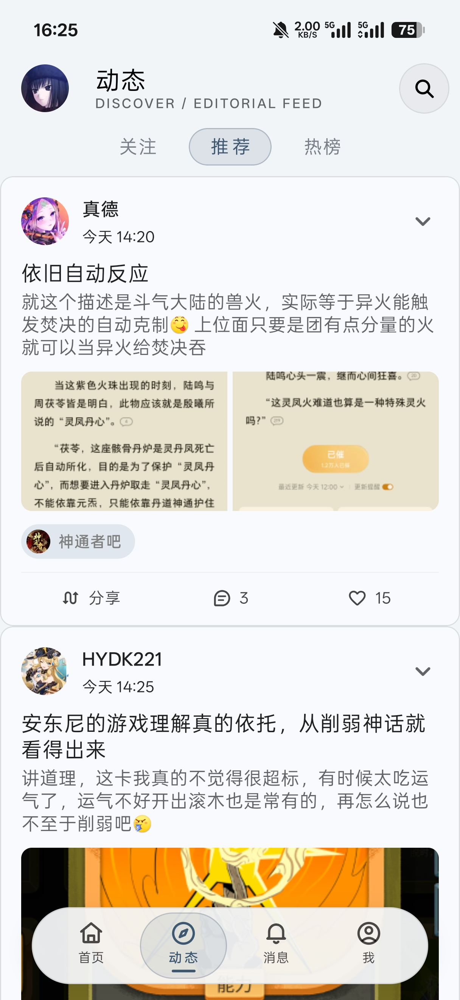
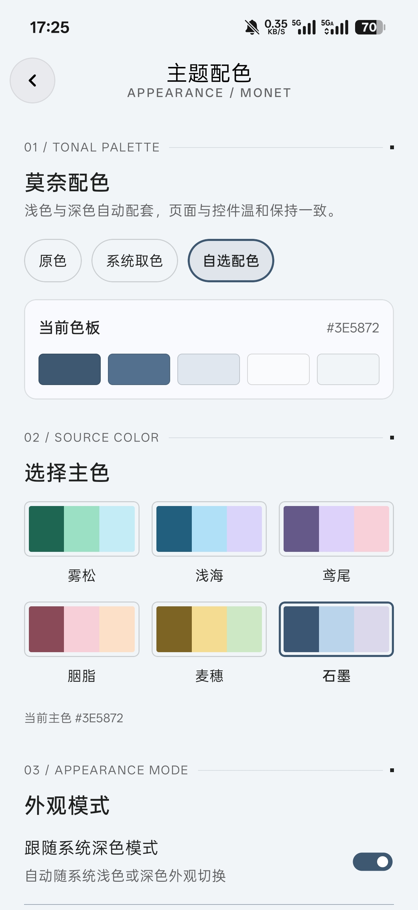

# 
贴吧 Lite+ (TiebaLitePlus)

    
    
    

**贴吧 Lite+** 是基于 [HuanCheng65/TiebaLite](https://github.com/HuanCheng65/TiebaLite)（`4.0-dev` 分支）深度定制的第三方贴吧 Android 客户端，视觉语言参考 [Wenku8_Flutter](https://github.com/mikufoxxx/Wenku8_Flutter) 的**极简纸感编辑风**，并针对日常阅读体验与 Android 15 进行了全面优化。

---

## 界面预览

    
    &nbsp;&nbsp;&nbsp;&nbsp;
    

    
    &nbsp;&nbsp;&nbsp;&nbsp;
    

---

## 核心特性

- **共存安装**：独立包名后缀 `.custom`、应用名 `贴吧 Lite+`，可与原版贴吧 Lite 或官方贴吧共存。
- **极简纸感编辑风**：
  - 6 套低饱和东方莫奈色板（雾松 / 浅海 / 鸢尾 / 胭脂 / 麦穗 / 石墨）全槽位着色，深浅双色无缝适配。
  - `10dp` 极细线框纸感卡片、英文等宽眉标页眉、全站一二级页面与 5 个设置二级页视觉统一。
  - 悬浮半透明液态胶囊底栏（按压果冻形变 + 弹簧滑块高亮 + 纤细线性动画图标）与斜切揭幕转场。
- **清爽启动与图标**：
  - 全新经典牛仔蓝 `#1F4B7A` 极简剪影默认图标（设置中保留「旧图标」可选）。
  - 极简纯净画布启动页与 220ms 轻柔淡出退场动画。
- **实用增强**：
  - 支持自定义默认启动页；
  - 屏蔽关键词/用户回复时的警告拦截弹窗；
  - 精简冗余与过时设置项，保留清爽直觉的设置结构。
- **现代 Android 适配**：
  - 升级至 `targetSdk 35`（Android 15）；
  - 全面启用 Edge-to-Edge 沉浸式系统栏与 WindowInsets 边距校准；
  - 启用 Android 预测性返回手势（Predictive Back）。

---

## 下载与安装

- **正式 / 预览版**：前往 [Releases](https://github.com/FunnyVamp404/TiebaLitePlus/releases) 页面下载最新 APK 直接安装。
- **最新构建**：前往 [GitHub Actions](https://github.com/FunnyVamp404/TiebaLitePlus/actions/workflows/build.yml) 下载最新 `release-*.apk` 构建产物。

---

## 致谢

- 上游项目：[HuanCheng65/TiebaLite](https://github.com/HuanCheng65/TiebaLite)
- 视觉与动效参考：[mikufoxxx/Wenku8_Flutter](https://github.com/mikufoxxx/Wenku8_Flutter)
- 协议与生态参考：
  - [Starry-OvO/aiotieba](https://github.com/Starry-OvO/aiotieba)
  - [n0099/tbclient.protobuf](https://github.com/n0099/tbclient.protobuf)

## 说明

**本软件及源码仅供学习交流使用，严禁用于商业用途。**
